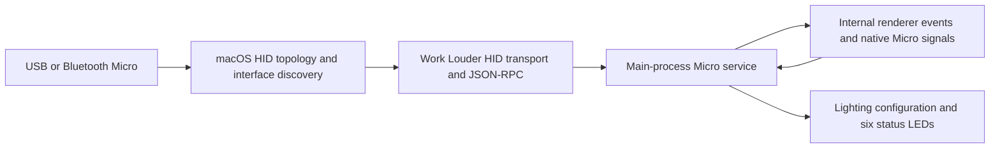

# Local IPC and native Codex Micro investigation

Investigated 2026-10-31 on macOS, desktop `26.1027.30824` (build `22943`).
Branch: `future/local-ipc-investigation`, based on `future/opendeck-base`.

## Conclusion

Desktop local IPC is a demonstrated candidate for launcher-free **local task
status acquisition**. An isolated probe connected without CDP, discovered a
thread owner, subscribed to an initial state snapshot and live patches, and
read the thread's model settings. This is not yet a replacement for the full
OpenDeck integration or the six native Micro assignments.

The current desktop process was still the debug-enabled session started in
the preceding compatibility test. The probe itself used only a Unix socket:
no debug endpoint, renderer evaluation, feature-gate override, app patch,
restart, or device emulation. A fresh ordinary app launch is the remaining
end-to-end validation step. Static inspection found no dependency on a
remote-debugging flag in the desktop IPC router/client startup path; local
client coordination can instead depend on the configured app-server route.

The installed OpenDeck plugin remains the tested `0.7.0.1002` baseline.
The experimental probe is not imported into the plugin or launcher.

## Public documentation and private interfaces

[OpenAI's Micro guide](https://learn.chatgpt.com/docs/features/codex-micro)
documents automatic detection over USB/Bluetooth, macOS Input Monitoring,
chat status lights, and configurable controls. It does not document a public
Micro transport API.

[OpenAI's app-server guide](https://learn.chatgpt.com/docs/app-server)
documents thread status notifications and separate stdio/WebSocket/Unix-socket
transports. That public app-server protocol is **not** the length-prefixed
desktop coordination protocol at `~/.codex/ipc/ipc.sock` described below.
Treat the latter as an undocumented, version-sensitive desktop interface.

## Desktop IPC: observed behavior

The current-user socket is `~/.codex/ipc/ipc.sock`. The app secures its directory
to `0700` and socket to `0600`. Frames contain a four-byte little-endian byte
length followed by UTF-8 JSON; this is not HTTP or plain JSONL.

The desktop code separates an IPC router, clients, thread-owner discovery,
and per-thread follower operations. The probe uses its own client type and
does not claim to be the desktop or an owner.

| Operation | Observed protocol/version | Result |
| --- | --- | --- |
| Initialize a client | `initialize`, version 0 | Succeeded |
| Observe loaded/followed thread IDs | `thread-stream-following-changed`, version 1 | One local thread observed on connection |
| Locate its existing owner | `thread-owner-discovery`, version 1 | Succeeded |
| Subscribe/unsubscribe | Targeted `thread-stream-following-changed` with `following` true/false | Succeeded; subscription removed at exit |
| Read initial state | `thread-stream-state-changed`, version 11, snapshot | One snapshot received |
| Observe subsequent updates | Same method, revisioned patches | Two patches in the repeatable 15-second probe; additional scratch runs also received updates |
| Read model configuration | `thread-follower-read-model-settings`, version 1 | Succeeded; values omitted from the report |

The initial state includes runtime status and unread state. The probe observed
`working` from an active local thread. Approval-waiting, input-waiting, idle,
unread, error, and unloaded projections have fixture coverage; these other
states have not all been induced in a real task during this investigation.

Only a small status projection is retained. Conversation snapshots and patches
can also carry prompts, answers, titles, paths, and tool content. The probe
receives those frames but discards unrelated fields; its saved report contains
no task IDs, titles, messages, paths, account data, or model configuration.
On an unsupported status patch or revision gap it requests a fresh snapshot
rather than applying arbitrary patches to an entire conversation object.

```sh
npm run probe:ipc -- --duration-ms 15000
# Optional: request an explicit known local thread instead of observing followers.
npm run probe:ipc -- --duration-ms 15000 --thread <thread-id>
```

Aggregate results are written to ignored `outputs/local-ipc-probe.json`.
No matching observed follower means the automatic-discovery test is
inconclusive; an initialized socket alone does not demonstrate status access.

The probe permits only initialization, owner discovery, model-settings reads,
and temporary status subscriptions. It refuses to handle routed requests for
other clients. It does not approve/reject requests, submit text, interrupt
turns, change settings, mark chats read, or obtain thread ownership.

## What native Codex Micro actually does

The following comes from static inspection of the user's installed app and
its bundled device SDKs. Physical Micro hardware was not exercised.
Protected SDK/app code and artwork are excluded from the repository.



1. A native HID topology watcher enumerates supported interfaces and reacts
   to attach/detach changes. The app matches vendor ID `0x303A`, Codex Micro
   product ID `0x8360`, or Creator Micro 2 product IDs `0x8297` / `0x8298`, with
   vendor usage page `0xFF00`. It prefers USB when multiple transports exist.
2. Bundled `@worklouder/device-kit-oai` `0.2.1` and `@worklouder/wl-device-kit`
   `0.2.2` provide the device connection. On macOS, the HID interface is opened
   non-exclusively. Connection state progresses through not-detected,
   detected, connected, or error; initial lighting RPC failures can mark the
   control plane unavailable and trigger bounded reconnect attempts.
3. The device uses vendor JSON-RPC over HID reports. The implementation sends
   64-byte reports with up to 61 payload bytes each. Key/joystick notifications
   and lighting calls have distinct vendor method names; they are not a Unix
   socket or ordinary typed keyboard shortcuts.
4. The main process converts input into internal
   `codex-micro-device-state-changed`, `codex-micro-hid-event`, and
   `codex-micro-joystick-event` messages. A main-process service manages the
   primary window, ownership, lock-screen behavior, and single/double taps.
5. The renderer selects six tasks according to recent/pinned/priority/custom
   settings and derives status/selection. It supplies agent assignments and a
   lighting model back to the main process. The main process maps statuses to
   per-key lighting and sends them to the device.

Thus task state and six-slot selection are calculated by the desktop app,
not discovered by the keyboard. The native route does not require CDP.
The existing community launcher instead announces a connected device and
reads/dispatches renderer internals over CDP; it does not create a real HID
device or connect through the physical Micro SDK.

The internal Micro host service has state, assignment, permission, and lighting
operations, but that renderer-to-main service is a different interface from
the desktop Unix-socket router. Finding an internal `getState` method does not
make it callable through the socket's thread-coordination method registry.

## Normal-launch verification (2026-10-31)

The desktop app was gracefully terminated and opened with `/usr/bin/open -a`,
without launcher or debug arguments. The new main process had no remote-debugging
arguments. The first 20-second IPC probe initialized but received no task
announcements, snapshots, or patches. This is a connection result, not a successful
task-status result.

After a local chat was active, a separate 12-second probe on that same normally
launched app found one owner, received one snapshot and seven patches, and observed
`working`. Model-settings reading also succeeded. No CDP connection was used.
This proves normal-launch status interoperability for a discovered local chat;
it does not prove a full task catalog or native Micro assignment discovery.

### Preserve the app's six assignments

The requested behavior is to keep selection and ordering in ChatGPT's Micro
settings, exactly as with the existing launcher. An alternative list populated
from the first six IPC announcements does not meet that requirement. No such
fallback has been installed into OpenDeck. A draft of that approach was removed
from the production controller before deployment.

The current desktop coordination socket does not expose the inspected
`CodexMicroHostService` instance. Its `getState`, `updateAgentThreadKeys`, and
`updateLighting` methods belong to the renderer/main service boundary. They are
not request handlers on the external thread-coordination socket. A follower
initialization does not announce a Micro device or enable the native Micro
runtime.

### Virtual HID feasibility

Follow-up: [the failure and signing investigation](VIRTUAL_HID_FEASIBILITY.md)
identifies the kernel entitlement rejection and a separate AMFI rejection for an
ad-hoc signed entitlement claim. It includes a reproducible benign probe and the
remaining requirements for a profile-authorized native recognition test.
The [comparison of related implementations](LAUNCHER_FREE_ALTERNATIVES.md) also
checks ThreadDeck's runtime inspector route against the installed app's fuses.

Apple provides `CoreHID.HIDVirtualDevice` and a virtual-HID entitlement. A minimal
unprivileged CoreHID creation check on macOS 26.5.2 returned
`virtualHidCreated=false`. It used an unrelated vendor-defined descriptor and
vendor ID, sent no input reports, installed no driver, and changed no system
security settings. This only demonstrates that this local process could not
create that virtual device; it does not prove that every privileged or entitled
virtual-HID design is impossible.

The installed app's macOS discovery uses its native HID-topology addon, followed
by product/usage-page checks and an HID transport connection. Merely setting an
IPC client type or a persisted "has ever been detected" flag cannot replace this
path. A virtual Micro implementation would need to pass native discovery and
support the device RPCs, including lighting initialization and reconnection.
Neither has been demonstrated here.

There is a second boundary: the inspected device-lighting messages contain a
numeric slot plus color, brightness, and effects, not the conversation identity
or title. Even successful virtual-device recognition alone would not establish
the mapping needed to label OpenDeck's six keys. That metadata path needs a
separate solution; it must not be inferred by matching statuses or event order.

References: [Apple HIDVirtualDevice](https://developer.apple.com/documentation/corehid/hidvirtualdevice),
[creating virtual devices](https://developer.apple.com/documentation/corehid/creatingvirtualdevices),
[virtual-HID entitlement](https://developer.apple.com/documentation/bundleresources/entitlements/com.apple.developer.hid.virtual.device).

## Remaining gaps before a launcher-free plugin

| Capability | Finding / next step |
| --- | --- |
| Local loaded-task status | Demonstrated over IPC; turn projection into a reconnecting status source |
| Task discovery from a cold start | Existing follower announcements cover loaded/followed tasks, not a complete task catalog; investigate a supported catalog path |
| Exact native six-slot assignments and selected UI tab | No corresponding desktop IPC request handler found in the inspected registry; unresolved |
| Chat switching / foreground focus | Not demonstrated via this IPC protocol; evaluate the existing thread deep links separately |
| Approval, text submission, interruption | Internal follower request handlers exist, but mutations were deliberately not tested; require deliberate, typed action design |
| Account usage / Micro layout and settings | No matching handler demonstrated on this socket; unresolved |
| Cloud/remote hosts | Probe currently limits discovery to `local`; not validated |
| Physical-device emulation | Separate, substantially larger approach requiring HID behavior and macOS permission/entitlement investigation; unnecessary for the proven IPC status path |

For this fork, an independent discovered-thread list is out of scope: the user
requires ChatGPT's own six-slot selection. Keep production on the native bridge
until an authoritative assignment source is demonstrated. IPC status projection
can then subscribe to those exact identities without inventing assignments.
Normal-launch full integration remains incomplete.

## Validation

- TypeScript check passed.
- 160 automated tests passed; one Windows-only test skipped.
- Plugin build/manifest validation and all three release audits passed.
- The repeatable 15-second IPC probe initialized, found one owner, received one
  snapshot and two live patch messages, observed `working`, and read model
  settings successfully. It used no CDP connection.
- Framing tests cover byte fragmentation, UTF-8, multiple frames, and invalid
  announced lengths. Projection tests cover revision gaps, content exclusion,
  approval/input/error/unloaded states, and unsupported flag-array patches.
- Normal-launch restart and IPC status verification were performed as described
  above. The installed OpenDeck plugin remains unchanged; it still requires the
  launcher for native assignment/status synchronization.
